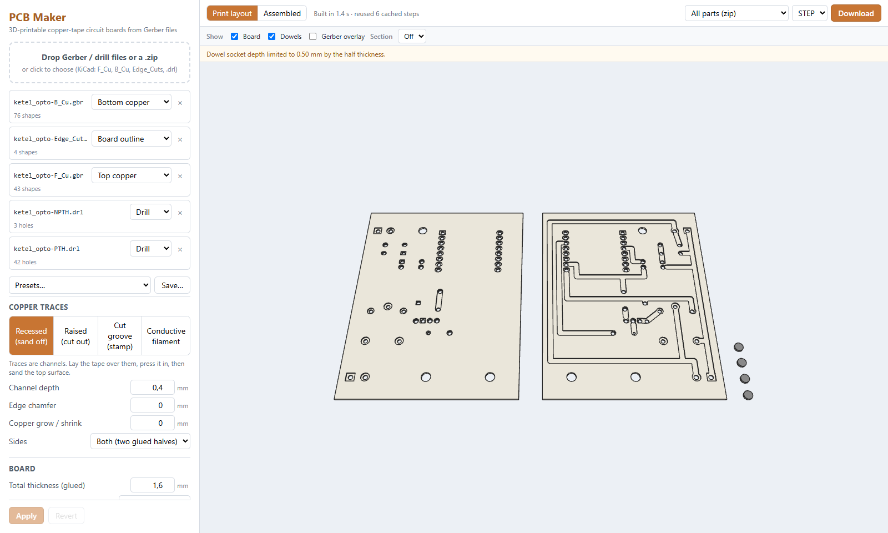

# PCB Maker

[](https://github.com/ronaldmourik/3d_pcb_maker/actions/workflows/ci.yml)
[](LICENSE)

Browser app that turns Gerber + Excellon exports (KiCad or any EDA tool) into 3D-printable circuit boards for copper tape or conductive filament.

**Try it:** https://ronaldmourik.github.io/3d_pcb_maker/ — everything runs locally in your browser; your files are never uploaded.



## How it works

1. Export Gerbers and drill files from your PCB tool and drop them (or a zip) into the app.
2. Pick a trace mode and settings, click **Apply**, and check the 3D preview and the printability report.
3. Download the board (STEP, STL or 3MF) and print it.
4. Lay copper tape over the board: press it into the channels and sand the top flush (recessed), or cut it along the raised traces (raised). Optional press stamps and vinyl-cutter patterns help with both.
5. Solder through-hole parts through the printed holes.

**Trace modes**
- **Recessed**: channels you press copper tape into and sand flush.
- **Raised**: traces stand proud and you cut the tape along them.
- **Cut groove**: the board is flat, with a groove around every trace (default 0.8 mm wide and 0.6 mm deep, measured outward from the trace edge). To use it:
  1. Stick copper tape over the board.
  2. Press the stamp on. Its ridge (groove width minus the clearance on each side) pushes the tape into the groove and tears it at the trace edge. The ridge is square by default; optionally it is stepped, with a half-width tip against the trace edge.
  3. Peel off the waste.
- **Conductive filament**: traces are a second material, embedded flush or on top. Each net gets a resistance estimate.

**Geometry**
- Traces, pads, regions and copper pours (including KiCad's "fractured" zone fills) are merged into one copper shape. Drill holes and slots are cut through.
- **Leave filled zones as leftover copper** (cut groove and raised modes): filled zones and all copper connected to them are left unprocessed, so the tape left over there becomes the zone. A separator groove along each zone outline keeps zones apart.
- Optional exact 45° **edge chamfer**: on the rim of recessed channels, or on the top edges of raised traces.
- **Double-sided** boards are generated as two halves (copper-side up, bottom half mirrored) with alignment dowels to glue them together.
- Optional **press stamp**: ribs for recessed boards, or pockets with an optional cutting ridge for raised boards, or a tear ridge for cut groove boards, with alignment pins in the larger holes.
- **Silkscreen** layers are engraved into the copper face, or embossed on it in raised mode. Thin text lines are widened to a printable width. With **Separate filament** the marks become their own body in a colour you pick (a flush inlay in the engraving, or a layer on top when embossed), so you can print them in a different filament.

**Checks and exports**
- **Printability check**: reports traces and pads narrower than 2× the nozzle, too-small gaps between copper, holes that are too small and thin channel floors. Each issue is clickable and shows a red marker in the preview.
- The geometry is a true B-rep built with OpenCascade (replicad). The preview is the generated STEP shown in Online3DViewer.
- Downloads: STEP, STL or 3MF. 3MF exports use named materials (Board, Copper, Conductive, Silkscreen) for multi-material printing.
- **Copper cut patterns** export as SVG or DXF (1:1, true arcs) for vinyl cutters.

**Working with the app**
- Settings only take effect when you click **Apply**. Unchanged stages are reused from a cache, so most rebuilds are quick.
- Settings and your own presets are remembered between visits. There are built-in presets for 0.4/0.6 mm nozzles and vinyl-cut tape.
- Preview controls:
  - print or assembled layout
  - per-body visibility
  - section plane
  - an overlay of the original Gerber copper

## Usage

```bash
npm install
npm run dev      # http://localhost:5173
npm test         # parser + geometry tests (OpenCascade runs in Node)
npm run build    # static site in dist/ (installable, works offline after the first visit)
```

In KiCad:
1. Use *File → Fabrication Outputs → Gerbers*: F.Cu, B.Cu, Edge.Cuts, and optionally F/B.Silkscreen.
2. Use *Drill Files* to export the Excellon drill files.
3. Drop the files, or a zip of them, into the app. You can change any layer's role in the file list.

## Deploying (GitHub Pages)

`.github/workflows/ci.yml` type-checks, tests and builds on every push and pull request, and publishes `dist/` to GitHub Pages from `main`. To set it up:
1. Push the repository to GitHub.
2. Under *Settings → Pages*, choose **GitHub Actions** as the source.

The build uses relative paths, so it works under `https://<user>.github.io/<repo>/`. The service worker (`public/sw.js`) caches the app and the ~30 MB of WebAssembly on first use. Bump its `CACHE` name when you change files in `public/`.

## Structure

| Path | Purpose |
| --- | --- |
| `src/gerber/` | Gerber RS-274X parser (apertures, macros, regions, fractured pours, arcs, step-repeat, polarity), Excellon parser, outline chaining, layer detection |
| `src/geometry/faces.ts` | Exact 2D primitives → OpenCascade faces (arcs stay arcs) |
| `src/geometry/brep.ts` | Board / halves / dowels / stamps / silkscreen as B-rep solids, built in cached stages |
| `src/geometry/chamfer.ts` | Exact 45° chamfer tools (per primitive for channels, per boundary edge for raised traces) |
| `src/geometry/printability.ts` | Printability checks (narrow traces, vanished features, gaps, holes) |
| `src/geometry/output.ts` | Preview layout and STEP / STL / 3MF / SVG / DXF export |
| `src/geometry/worker.ts` | Web Worker that owns OpenCascade, the geometry cache and the last built model |
| `src/state/` | App state hook, settings, persistence and presets |
| `src/ui/` | React UI: upload, layers, settings, viewer, view controls, issues, export |

Notes:
- Copper is fused in 2D and extruded once, which is much faster than fusing 3D solids.
- `scripts/copy-occt.mjs` copies occt-import-js into `public/occt/`. A Vite plugin points Online3DViewer at that copy, so the app works offline.

## Contributing

Issues and pull requests are welcome. See [CONTRIBUTING.md](CONTRIBUTING.md) for the development setup and test conventions, and [SECURITY.md](SECURITY.md) for reporting vulnerabilities. This project follows the [Code of Conduct](CODE_OF_CONDUCT.md).

## License

MIT, see [LICENSE](LICENSE). The built app bundles third-party packages under their own licenses, including two LGPL-2.1 OpenCascade WebAssembly builds; see [THIRD_PARTY_NOTICES.md](THIRD_PARTY_NOTICES.md).
